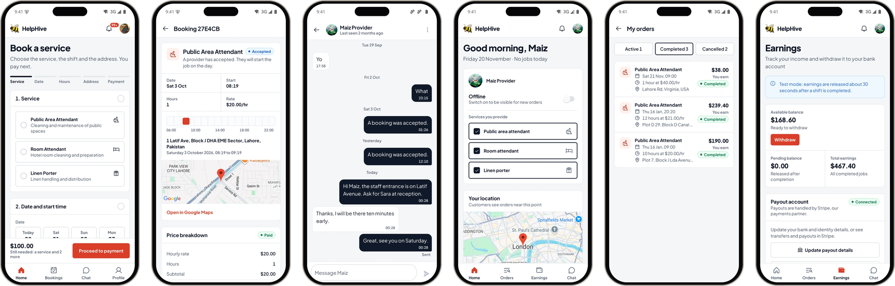

# HelpHive Frontend

This repo contains the Expo-based Android app for the HelpHive platform.



## Setup

### 1. Install Dependencies

```bash
npm install
```

### 2. Environment Variables

Copy `.env.example` to `.env` and fill it in. Every `EXPO_PUBLIC_` value is compiled into the app, so none of them is
a secret.

| Variable                                               | Purpose                                                                                               |
| ------------------------------------------------------ | ----------------------------------------------------------------------------------------------------- |
| `EXPO_PUBLIC_BACKEND_URL`, `EXPO_PUBLIC_WEBSOCKET_URL` | API and WebSocket base URLs (`https://` and `wss://api.helphive.himaiz.com`).                         |
| `EXPO_PUBLIC_GOOGLE_MAPS_API_KEY`                      | Google Maps key, restricted to this app's package and signing key.                                    |
| `EXPO_PUBLIC_ONESIGNAL_APP_ID`                         | OneSignal app id for push notifications.                                                              |
| `EXPO_PUBLIC_STRIPE_PUBLISHABLE_KEY`                   | Stripe publishable key (test mode today).                                                             |
| `EXPO_PUBLIC_GCLOUD_BUCKET_HELPHIVE_USERS`             | Cloud Storage bucket for profile pictures (`helphive-users`).                                         |
| `EXPO_PUBLIC_PLAY_INTEGRITY_PROJECT_NUMBER`            | Optional; defaults to the HelpHive Cloud project used for Play Integrity.                             |
| `EXPO_PUBLIC_ATTEST_DEBUG_TOKEN`                       | Only for emulator and local test builds, which can't pass Play Integrity. Never set it for a release. |

For a local backend on a physical device, use your computer's LAN IP instead of `localhost`, for example:

```env
EXPO_PUBLIC_BACKEND_URL=http://192.168.1.25:8080
EXPO_PUBLIC_WEBSOCKET_URL=ws://192.168.1.25:8080
```

### 3. Start the App

```bash
npx expo run:android   # builds a development app and installs it on a device or emulator
npm start              # the development server
```

Push notifications use OneSignal, which sends Android pushes with the Firebase Cloud Messaging credentials configured
in its own dashboard; no Firebase file is needed in this repo.

### 4. Useful Commands

-   List connected devices: `adb devices`
-   Type-check and lint: `npm run check`

## Development

### Linting and Formatting

Lint and format checks are automatically run on pull requests. Husky hooks ensure code quality on each commit using ESLint and Prettier.

### Scripts

-   **Start**: `npm run start` - Start the development server.
-   **Android**: `npm run android` - Run the app on an Android emulator or device.
-   **Web**: `npm run web` - Start the app in a web browser.
-   **Lint**: `npm run lint` - Run ESLint to check for code issues.
-   **Format**: `npm run format` - Run Prettier to format code.

## Deployment

The shared infrastructure (API, Cloudflare zone, secrets, client attestation, data) is described in
[helphive-backend/docs/infrastructure.md](https://github.com/Helphive/helphive-backend/blob/main/docs/infrastructure.md).
The app's part, checked against the live setup on 2026-11-22:

-   **Distribution:** Android APKs on [GitHub Releases](https://github.com/Helphive/helphive-app/releases) only. There is
    no Play Store listing and no Play Console account. Package id `com.himaiz.helphive.app`. iOS isn't built.
-   **CI:** `.github/workflows/lint.yml` runs on every pull request: `npm install --legacy-peer-deps`, `npm run
typecheck`, `npm run lint`, then Prettier, pushing any formatting fixes to the PR branch. No workflow builds the app.
-   **Releases (manual on purpose):** the maintainer builds each release locally, because EAS cloud builds queued for
    an hour on the free tier:

    1. In the release commit, set `version` in `app.config.js` and `package.json` (`1.N.0` for Production N, `1.N.x` for
       fixes, `1.N.0-beta.K` for test builds) and add the version's section to `CHANGELOG.md`.
    2. From a clean export of that commit: `npm ci`, then `npx expo prebuild --platform android --no-install`.
    3. Set `versionCode` in `android/app/build.gradle` higher than every earlier release (it starts at 1 after prebuild).
    4. Sign with the release keystore, kept by the maintainer outside every repo, and run
       `./gradlew assembleRelease`. With `HH_APK_ABIS=phones` set, the build contains only the phone ABIs (a smaller
       APK). Without it, the APK is universal.
    5. Check the APK's signing certificate, `versionCode`, that it points at `api.helphive.himaiz.com`, and that it
       contains no attestation debug token.
    6. Publish `helphive-phones.apk` and `helphive-universal.apk` with `gh release create v1.N.0` (tag `v1.N.0`, title
       "Production N (1.N.0)", notes from `CHANGELOG.md`). Betas are pre-releases (`--prerelease --latest=false`).

    `eas.json` is still in the repo, but EAS isn't used for releases. Its remote build counter is behind the real
    `versionCode`, so an EAS build would reuse an old number.

-   **Rollback:** Android won't install a lower `versionCode` over a higher one. To roll back, build the earlier commit
    with a new, higher `versionCode` and publish it as the latest release. Installing an older APK means uninstalling
    the app first, which clears its local data.
-   **Client attestation:** release builds prove they are genuine with Play Integrity. The API accepts a sideloaded APK
    only if it is signed with the release key and runs on a device that meets device integrity. So an APK signed with any
    other key, a debug build without a debug token, or a build on a modified device is refused on the protected routes.
-   **Secrets:** none in the app. The release keystore and its passwords stay with the maintainer, outside every repo.
    GitHub Actions secrets aren't used.
-   **Data:** none of its own on a server. The app keeps its session in the device's secure storage and reads and writes
    through the API.

## Notes

-   This project uses TypeScript.
-   OneSignal is used for push notifications.

## License

All rights reserved.
